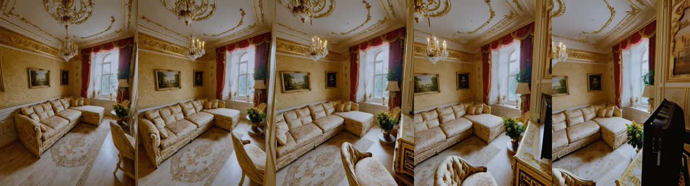

# Montage

Drone-style camera moves from a single photo, powered by [UniWorld-View](https://github.com/PKU-YuanGroup/UniWorld-View) on Modal.

We've tested an orbit and a flight through the same room. Both videos start from one image; unseen parts of the room are generated.



[Watch the fly-through](examples/flight.mp4) · [Watch the orbit](examples/orbit.mp4)

## Run

Install the Modal client and connect your account:

```sh
python -m pip install modal
modal setup
```

Run the bundled room example:

```sh
modal run modal_uniworld.py
```

For a longer flight with forward, sideways, and upward movement:

```sh
modal run modal_uniworld.py --frames 81 --angle -15 \
  --x 0.45 --y -0.12 --z 0.35 --output outputs/uniworld-flight
```

Add `--input /path/to/photo.jpg` to use your own photo. `--angle` controls the turn; `--x`, `--y`, and `--z` add camera movement. Frame counts must be `4n+1`, such as 49 or 81.

Video inputs use the moving-scene pipeline. For a roughly 2.6-second clip:

```sh
modal run modal_uniworld.py --input /path/to/clip.mp4 \
  --frames 41 --fps 16 --angle 40 --output outputs/video-orbit
```

Choose a frame count that fits your clip at the requested fps. Video runs also download and cache STream3R geometry weights.

Results download to the output folder. Open `diffusion_correct.mp4` for the final video.

The runner uses an A100 80 GB, downloads roughly 60 GB of weights on the first run, and caches them in the `uniworld-view-data` Modal Volume. GPU jobs stop when finished; cached storage persists. Modal usage is billed to your account.

The sample image and model come from UniWorld-View (Apache-2.0). The examples above were generated with its bundled room image. See [CONTEXT.md](CONTEXT.md) for the broader project plan.
